<!-- _class: title -->
<!-- _paginate: false -->
<!--
[Slide 1 · ~9 giây]
"Kính chào thầy cô và các bạn. Chúng em là nhóm INOVAT. Hôm nay, chúng em xin giới thiệu bảo tàng ảo về bốn cuộc cách mạng công nghiệp."
-->

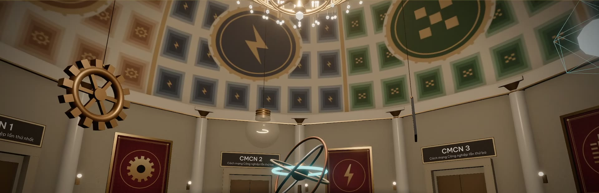

INOVAT

Bảo tàng Cách mạng Công nghiệp

Bốn cuộc cách mạng · một dòng chảy phát triển

---

<!-- _class: intro -->
<!--
[Slide 2 · ~24 giây]
"Các cuộc cách mạng công nghiệp hình thành từ nhiều nguyên nhân khác nhau. Những điểm yếu, những giới hạn của thời trước chính là động lực để con người cải tiến, và mở ra cuộc cách mạng tiếp theo. Qua nhiều cải cách, đổi mới, những sáng chế ấy trở thành những đồ dùng quanh ta ngày nay."
-->

Mở đầu

Các cuộc cách mạng công nghiệp hình thành từ <strong>nhiều nguyên nhân khác nhau</strong>. Những <strong>điểm yếu, điểm khuyết</strong> của cuộc cách mạng trước chính là động lực để con người cải tiến, mở ra cuộc cách mạng sau. Qua nhiều công cuộc cải cách, đổi mới, những sáng chế ấy trở thành <strong>những đồ dùng quanh ta</strong> ngày nay.

<figure>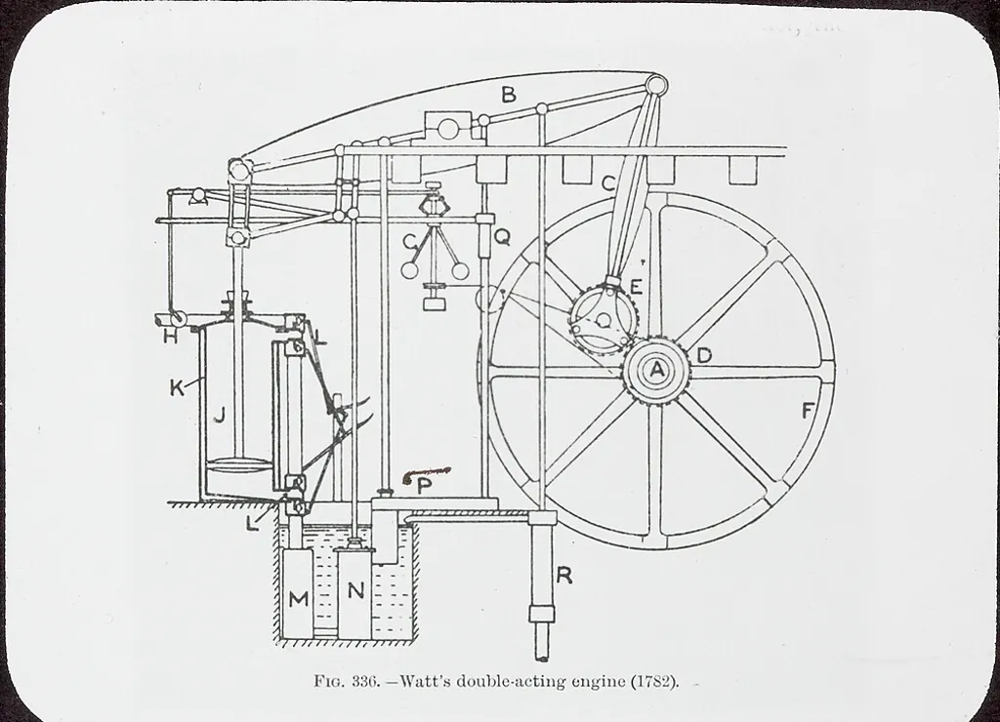<figcaption><b>CMCN 1</b>Máy hơi nước</figcaption></figure>

↓

<figure>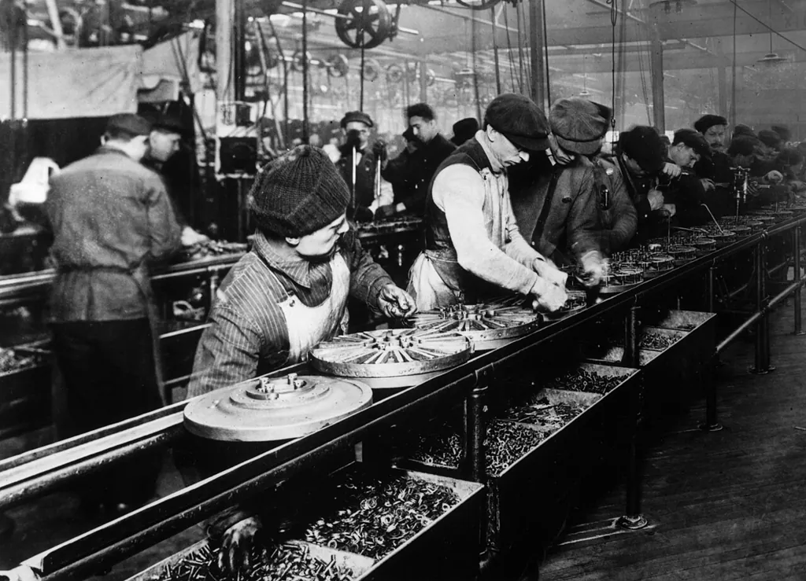<figcaption><b>CMCN 2</b>Dây chuyền lắp ráp</figcaption></figure>

↓

<figure>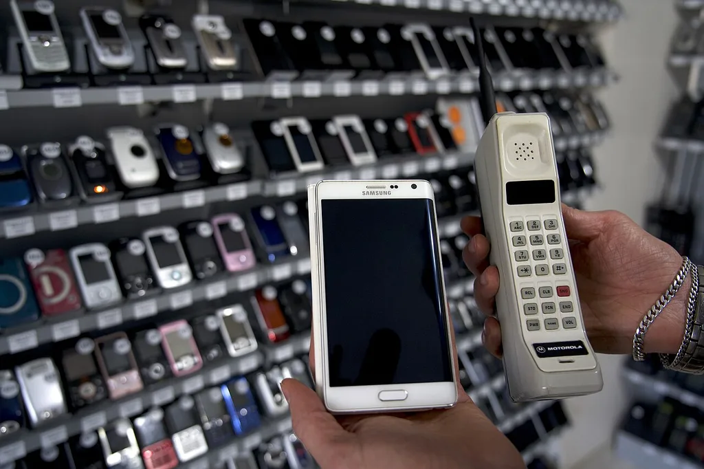<figcaption><b>CMCN 3</b>Điện thoại di động</figcaption></figure>

↓

<figure>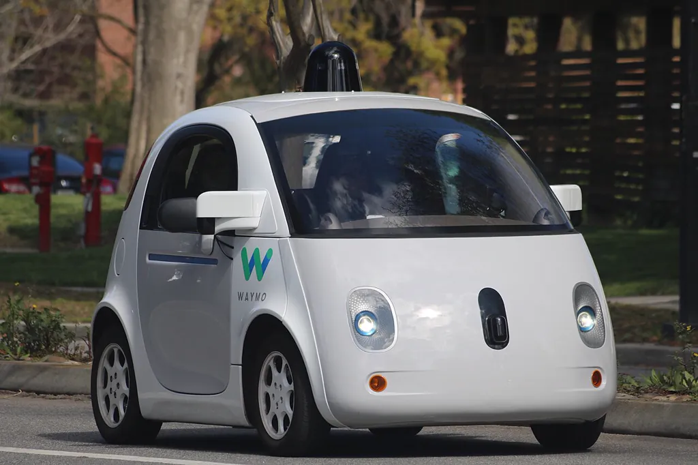<figcaption><b>CMCN 4</b>Xe tự lái</figcaption></figure>

---

<!--
[Slide 3 · ~33 giây]
"Vậy bốn cuộc cách mạng ấy là gì? Cách mạng thứ nhất, từ giữa thế kỷ mười tám, là cơ giới hóa: máy móc và máy hơi nước thay sức người, sức nước. Cách mạng thứ hai, cuối thế kỷ mười chín, đưa điện, thép và dây chuyền lắp ráp vào sản xuất hàng loạt. Cách mạng thứ ba, nửa sau thế kỷ hai mươi, là máy tính, robot và tự động hóa. Cách mạng thứ tư, từ đầu thế kỷ hai mươi mốt, là dữ liệu, kết nối và hệ thống thông minh."
-->

# Bốn cuộc cách mạng, một dòng chảy phát triển

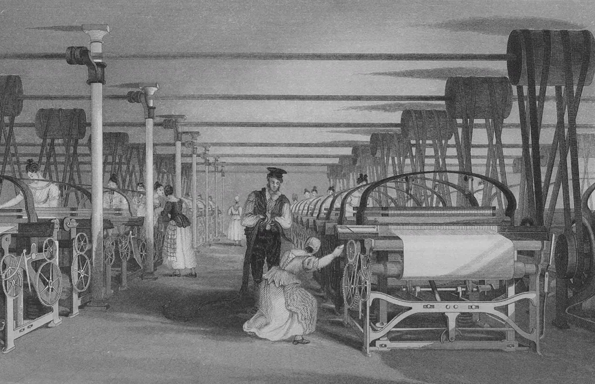
CMCN 1<h3>Cơ giới hóa</h3>
Giữa XVIII – giữa XIX

Máy móc và máy hơi nước thay sức người, sức nước.

T. Allom, J. Tingle · tranh khắc 1835 · phạm vi công cộng

CMCN 2<h3>Sản xuất hàng loạt</h3>
Cuối XIX – đầu XX

Điện, thép, động cơ đốt trong và dây chuyền lắp ráp.

Dây chuyền lắp ráp Ford, 1913 · phạm vi công cộng

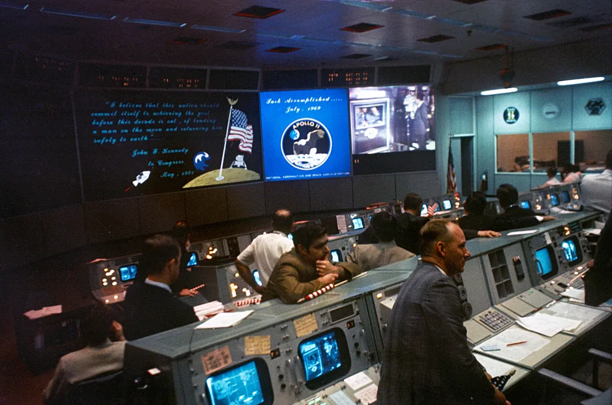
CMCN 3<h3>Tự động hóa và số hóa</h3>
Nửa sau XX

Máy tính, vi xử lý, robot và mạng máy tính.

NASA, Apollo 11, 1969 · phạm vi công cộng

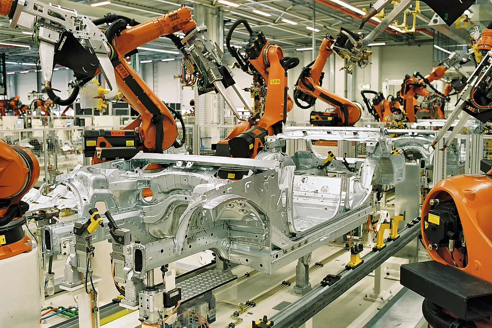
CMCN 4<h3>Kết nối và hệ thống thông minh</h3>
Đầu XXI đến nay

Dữ liệu, kết nối, trí tuệ nhân tạo, công nghệ sinh học.

BMW Werk Leipzig, 2005 · CC BY-SA 2.0 DE

---

<!--
[Slide 4 · ~35 giây]
"Bốn cuộc cách mạng không đứng riêng lẻ mà nối với nhau thành ba mạch. Về sản xuất: từ máy dệt cơ khí, đến dây chuyền lắp ráp, rồi robot và nhà máy thông minh. Về truyền thông: từ điện thoại, đến mạng máy tính, rồi điện thoại thông minh. Về nền tảng công nghệ: từ hơi nước, đến vi xử lý, rồi dữ liệu và trí tuệ nhân tạo. Cái đi sau dựa trên cái đi trước, nhưng đó là sự kế thừa, không phải hệ quả tất yếu."
-->

# Sự kế thừa và phát triển

<b>Sản xuất</b>

<figure><figcaption>Máy dệt cơ khí<i>1835</i></figcaption></figure>→
<figure><figcaption>Dây chuyền lắp ráp<i>1913</i></figcaption></figure>→
<figure><figcaption>Robot, nhà máy thông minh<i>2005</i></figcaption></figure>

<b>Truyền thông</b>

<figure>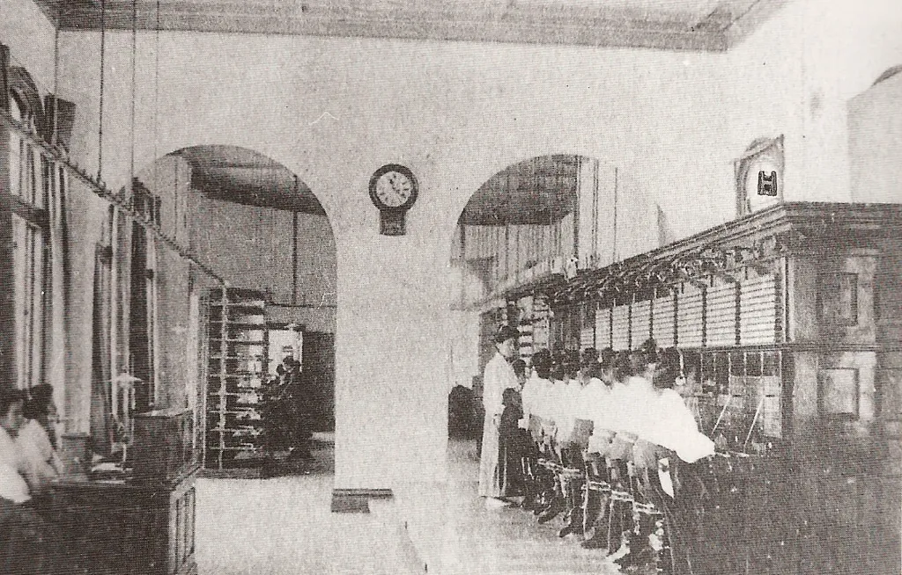<figcaption>Điện thoại<i>1902</i></figcaption></figure>→
<figure>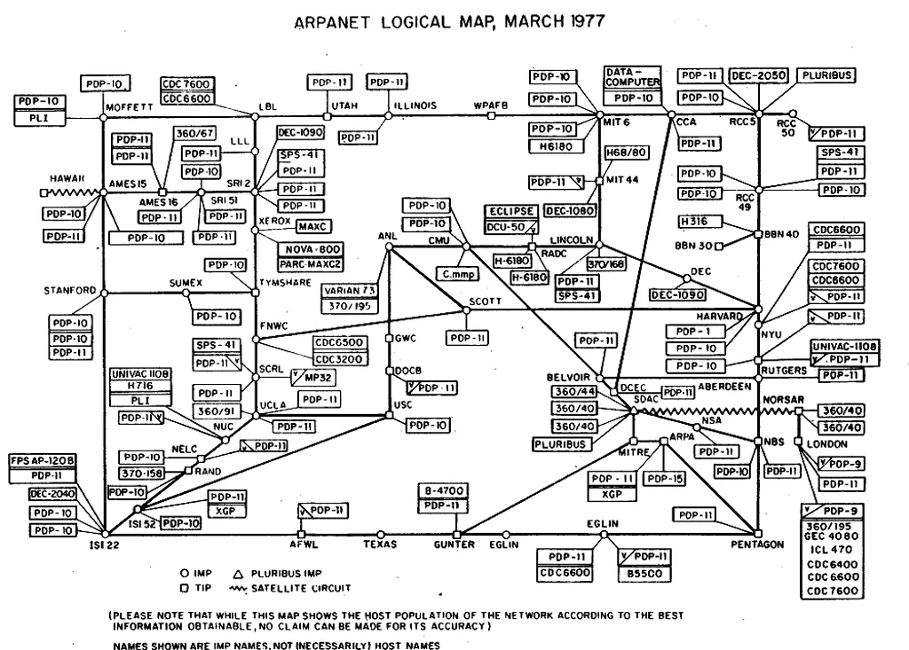<figcaption>Mạng máy tính ARPANET<i>1977</i></figcaption></figure>→
<figure><figcaption>Điện thoại thông minh<i>nay</i></figcaption></figure>

<b>Nền tảng công nghệ</b>

<figure><figcaption>Hơi nước<i>1782</i></figcaption></figure>→
<figure>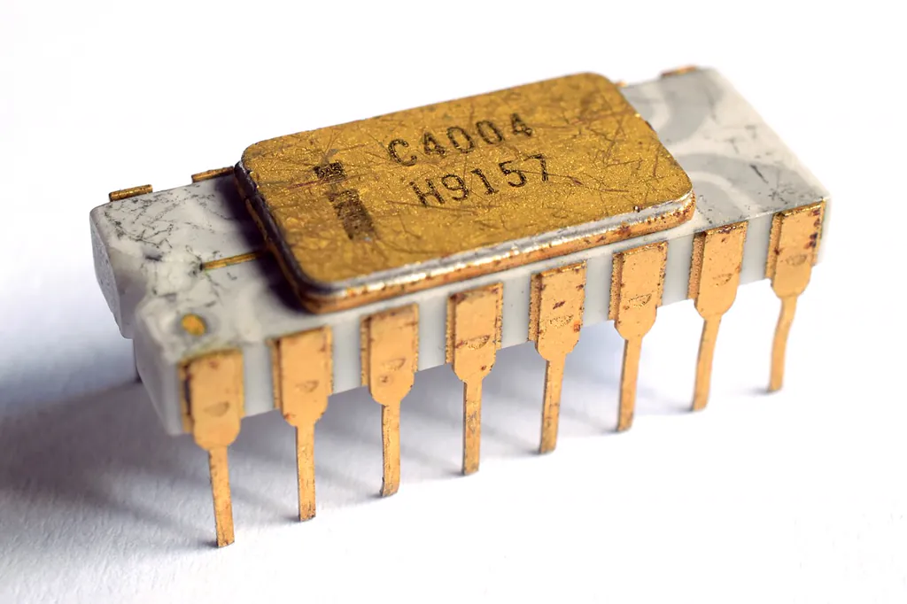<figcaption>Vi xử lý<i>1971</i></figcaption></figure>→
<figure>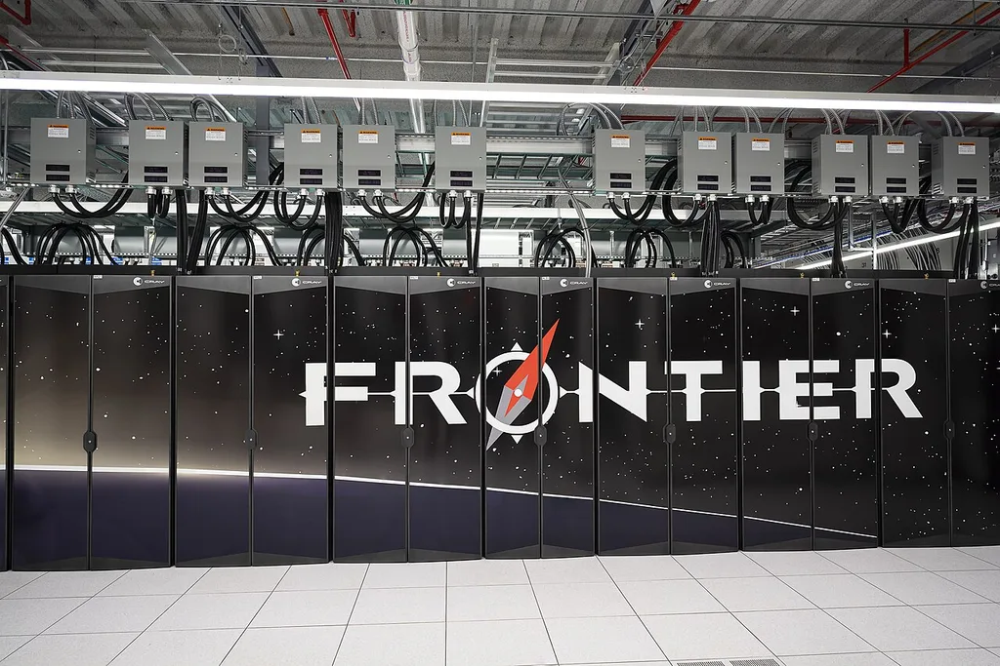<figcaption>Dữ liệu và AI<i>2022</i></figcaption></figure>

Kế thừa, <strong>không phải hệ quả tất yếu</strong>.

Ảnh: Wikimedia Commons (phạm vi công cộng hoặc Creative Commons); tác giả và giấy phép ghi trong notes/sources.md.

---

<!--
[Slide 5 · ~30 giây]
"Nhưng kế thừa không có nghĩa là lặp lại. Mỗi thời đại có một biến đổi riêng và để lại một thách thức mới. Cách mạng thứ nhất đưa sản xuất vào nhà máy, nhưng lao động nặng nhọc. Cách mạng thứ hai cho sản xuất hàng loạt, nhưng công việc đơn điệu. Cách mạng thứ ba cho tự động hóa, và nỗi lo mất việc. Cách mạng thứ tư có trí tuệ nhân tạo, cùng những câu hỏi về việc làm và đạo đức. Để thấy dòng chảy ấy, mời thầy cô và các bạn xem trailer."
-->

# Kế thừa, khác biệt và thách thức mới

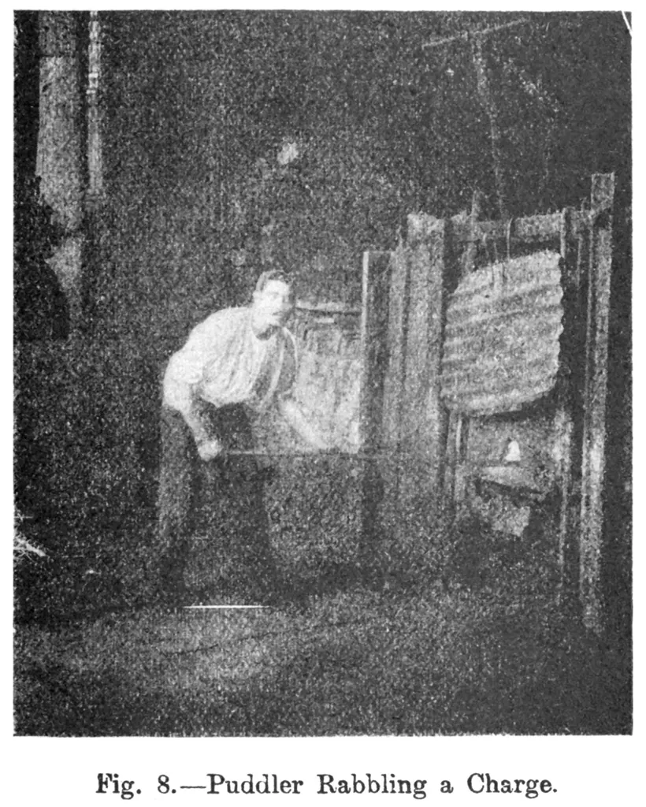
CMCN 1
Nhà máy cơ khí

Lao động nặng nhọc

W. Macfarlane · 1917 · PD

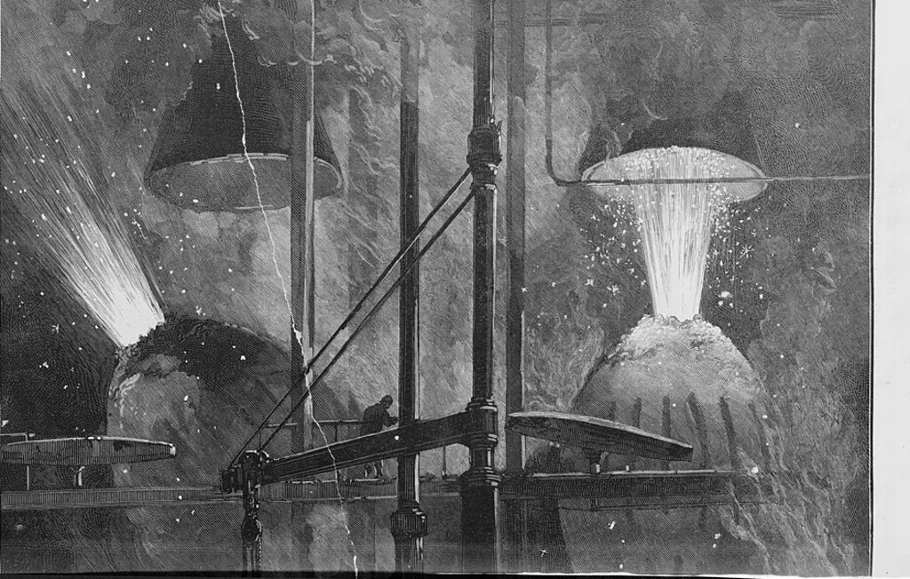
CMCN 2
Sản xuất hàng loạt

Công việc đơn điệu

C. Graham · 1886 · PD

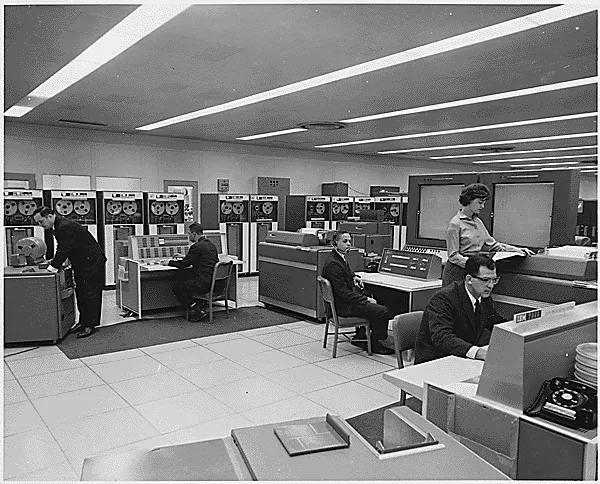
CMCN 3
Tự động hóa

Lo mất việc

NASA · khoảng 1962 · PD

CMCN 4
Dữ liệu và AI

Việc làm, đạo đức AI

Grendelkhan · 2017 · CC BY-SA 4.0

<i class="lg1"></i>Biến đổi<i class="lg2"></i>Thách thức

---

<!-- _class: trailer -->
<!-- _footer: "" -->
<!-- _paginate: false -->
<!--
[Slide 6 · Trailer · 37 giây · KHÔNG AI NÓI]
Video tự phát khi chuyển đến slide này (có âm thanh). Nếu không tự phát, bấm nút phát. Đứng yên, im lặng đến hết.
Khi trailer kết thúc, bấm sang slide tiếp theo.
-->

Trailer · 0:37

<video src="assets/video/trailer.mp4" poster="assets/video/trailer-poster.jpg" controls preload="auto" playsinline data-autoplay></video>

---

<!-- _class: prod -->
<!-- _paginate: false -->
<!-- _footer: "" -->
<!--
[Slide 7 · ~27 giây]
"Đó là INOVAT, hành trình khám phá lịch sử: một bảo tàng ba chiều chạy ngay trên trình duyệt, không cần cài đặt, có tiếng Việt và tiếng Anh. Bảo tàng gồm bốn phòng thời đại, hai mươi mốt phát minh, bảy mươi bốn hình ảnh trên tường và trên các bảng thông tin, và bốn vòng trò chơi. Mọi người có thể vào thử ngay tại địa chỉ này."
(74 hình ảnh = 60 ảnh, tranh, tranh khắc + 14 sơ đồ do nhóm vẽ; 48 trên tường các phòng + 26 trên bảng thông tin.)
-->

Sản phẩm của nhóm

<h1 style="font-size:38px;">INOVAT: Hành trình khám phá lịch sử</h1>

Bảo tàng ảo 3D chạy ngay trên trình duyệt · Tiếng Việt và English

<svg viewBox="0 0 48 48" aria-hidden="true"><path d="M10 42V14a14 14 0 0 1 28 0v28M5 42h38M18 42V24a6 6 0 0 1 12 0v18"/></svg>
<b>4</b>phòng thời đại

<svg viewBox="0 0 48 48" aria-hidden="true"><path d="M24 5a12.5 12.5 0 0 0-7 22.9V33h14v-5.1A12.5 12.5 0 0 0 24 5zM18 38h12M20.5 43h7"/></svg>
<b>21</b>phát minh

<svg viewBox="0 0 48 48" aria-hidden="true"><rect x="6" y="9" width="36" height="30" rx="2"/><circle cx="17" cy="20" r="3.5"/><path d="M6 34l11-10 8 7 7-6 10 9"/></svg>
<b>74</b>hình ảnh

<svg viewBox="0 0 48 48" aria-hidden="true"><rect x="4" y="15" width="40" height="22" rx="11"/><path d="M15 21v10M10 26h10"/><circle cx="32" cy="23.5" r="1.8"/><circle cx="37" cy="28.5" r="1.8"/></svg>
<b>4</b>vòng trò chơi

inovat-museum.vercel.app

---

<!--
[Slide 8 · ~23 giây]
"Hành trình đi từ sảnh trung tâm, qua bốn phòng theo đúng thứ tự thời gian, rồi đến phòng trò chơi. Bước qua mỗi cánh cửa là bước sang một thời đại. Cuối cùng, cánh cổng chỉ mở khi hoàn thành trò chơi."
-->

# Cấu trúc bảo tàng: một hành trình theo thời gian

1
<h3>Sảnh trung tâm</h3>
Chào mừng, lộ trình, bản đồ và bảng ghi công.

2
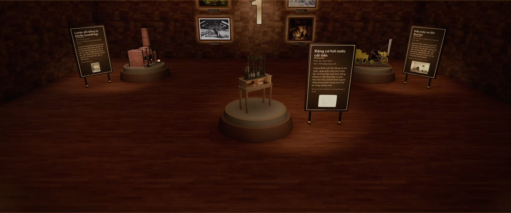<h3>Phòng CMCN 1</h3>
5 phát minh, từ máy hơi nước đến điện báo.

3
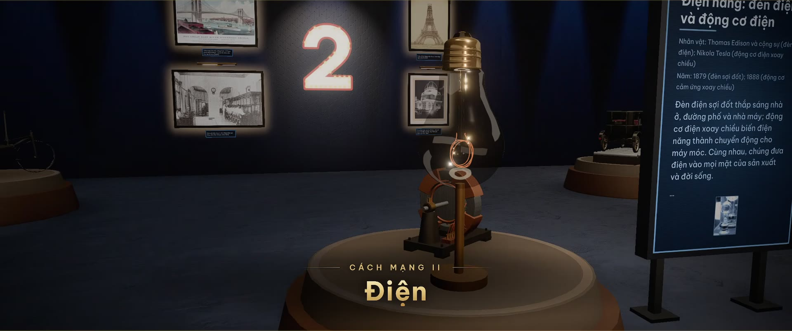<h3>Phòng CMCN 2</h3>
5 phát minh, từ thép Bessemer đến điện thoại.

4
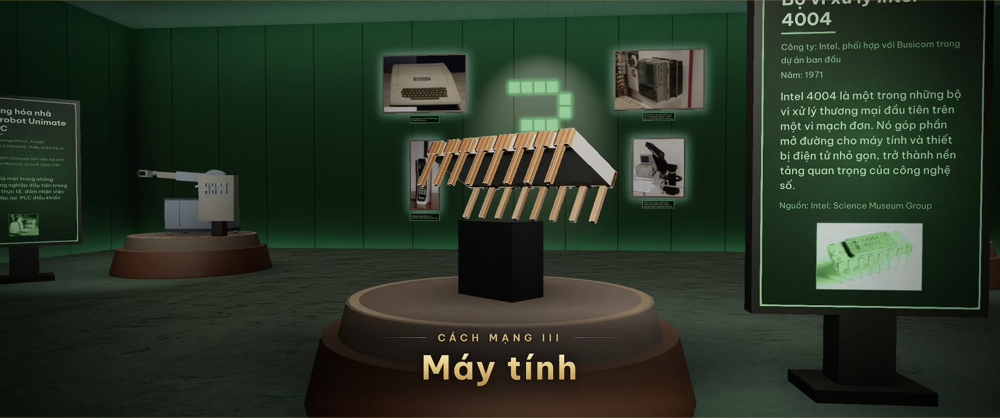<h3>Phòng CMCN 3</h3>
5 phát minh, từ vi xử lý đến Web.

5
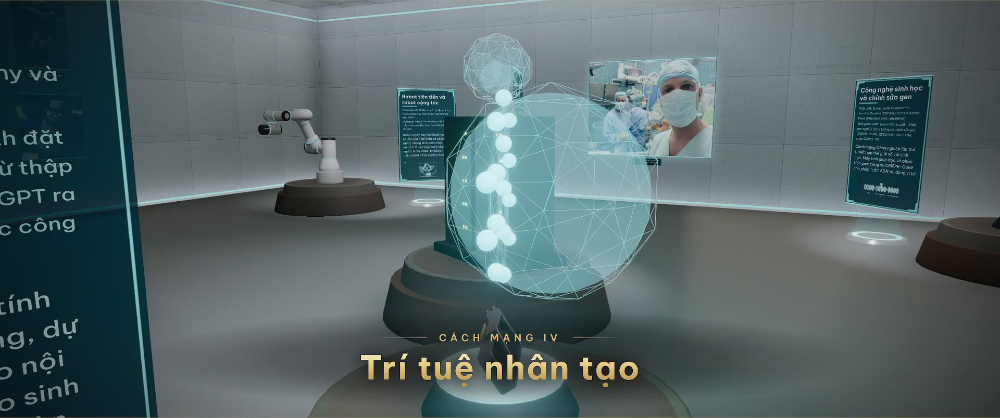<h3>Phòng CMCN 4</h3>
6 phát minh, từ in 3D đến công nghệ sinh học.

6
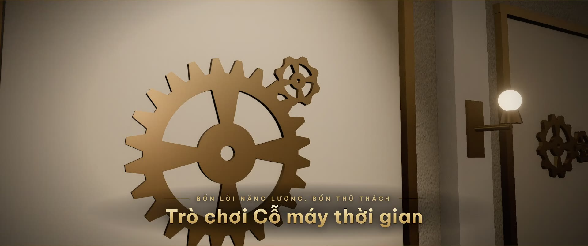<h3>Phòng trò chơi</h3>
Cỗ máy thời gian. Hoàn thành để mở cánh cổng.

---

<!--
[Slide 9 · ~21 giây]
"Mỗi thời đại có một bản sắc thị giác riêng: màu ấm của gạch và đồng cho hơi nước, xanh thép cho điện, xanh lục cho máy tính, ánh lam trong suốt cho kỷ nguyên số. Nhìn màu sắc là biết mình đang ở đâu trong dòng thời gian."
-->

# Bốn thời đại, bốn bản sắc thị giác

<figure><figcaption><b>CMCN 1</b>Gạch, đồng và ánh lửa ấm của thời hơi nước</figcaption></figure>
<figure><figcaption><b>CMCN 2</b>Xanh thép và bảng tối của thời điện</figcaption></figure>
<figure><figcaption><b>CMCN 3</b>Màn hình xanh lục của thời máy tính</figcaption></figure>
<figure><figcaption><b>CMCN 4</b>Kính trong và ánh lam của kỷ nguyên số</figcaption></figure>

---

<!--
[Slide 10 · ~24 giây]
"Trong mỗi phòng, mỗi hiện vật có một bảng thông tin. Đến gần, người xem có thể mở bảng phóng to, kèm mô hình ba chiều xoay được và nguồn tham khảo. Hình ảnh có ở khắp nơi: trên các bảng thông tin và trên tường các phòng, tổng cộng bảy mươi bốn hình ảnh, để người xem vừa đọc vừa nhìn tư liệu thật."
-->

# Trong mỗi phòng: hiện vật, bảng thông tin, hình ảnh

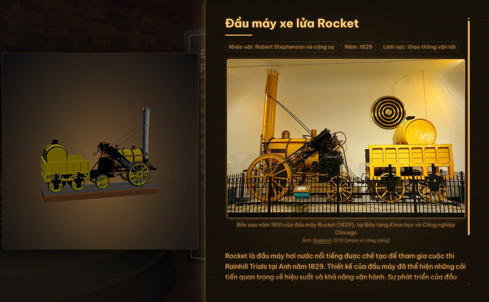

1
<h3>Mở từng hiện vật</h3>
Bảng thông tin phóng to, kèm <strong>mô hình 3D xoay được</strong> và nguồn tham khảo.

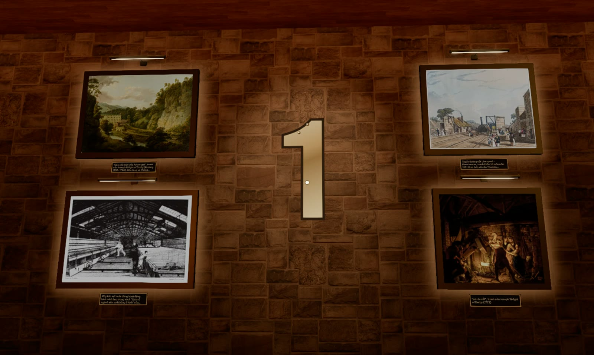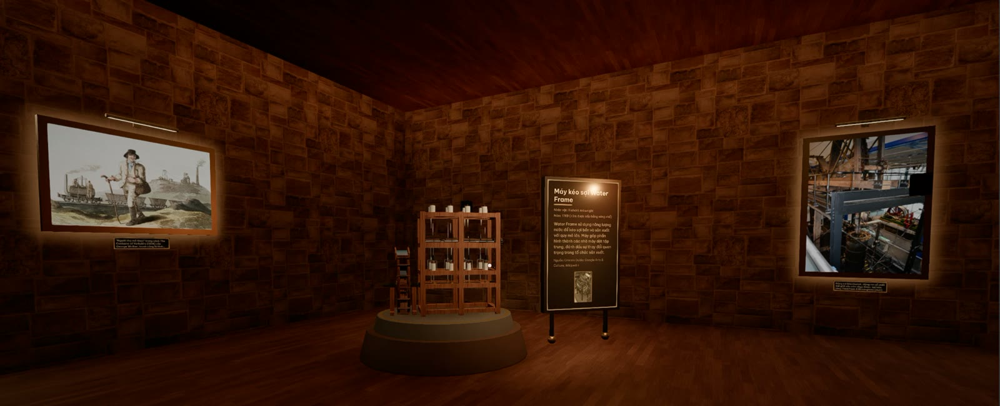

2
<h3>Hình ảnh ở khắp nơi</h3>
Trên tường các phòng và trên bảng thông tin: <strong>74 hình ảnh</strong> tư liệu và sơ đồ.

---

<!--
[Slide 11 · ~32 giây]
"Sau khi xem, người chơi phải vận dụng. Trò chơi Cỗ máy thời gian có bốn vòng. Vòng một: đưa các cỗ máy về đúng cuộc cách mạng. Vòng hai: giúp một thị trấn lớn lên qua bốn thời kỳ. Vòng ba: đoán phát minh từ các gợi ý. Vòng bốn: trò chuyện với những vị khách từ quá khứ về cái giá của đổi thay. Trả lời sai thì được gợi ý phòng cần xem lại."
-->

# Trò chơi "Cỗ máy thời gian": bốn vòng

I

<h3>Lạc giữa thời gian</h3>
Đưa mỗi cỗ máy về đúng cánh cửa cách mạng của nó.

II

<h3>Thị trấn lớn lên</h3>
Chọn phát minh giải quyết vấn đề của từng thời kỳ.

III

<h3>Tôi là ai?</h3>
Đoán điều bí ẩn từ gợi ý; đoán sớm được nhiều điểm hơn.

IV

<h3>Những vị khách từ quá khứ</h3>
Nói về đổi thay của mỗi thời và cái giá phải trả.

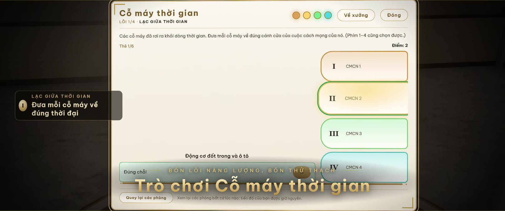

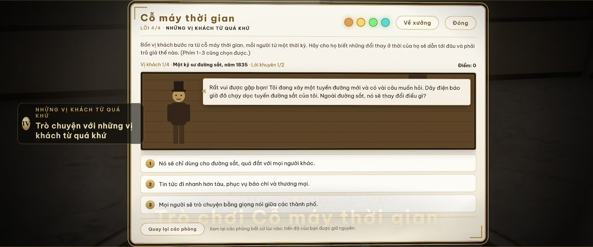

---

<!--
[Slide 12 · ~23 giây]
"Như vậy, người xem đi từ khám phá đến hiểu: quan sát hiện vật ba chiều, đọc bảng thông tin, đối chiếu ảnh và nguồn, rồi vận dụng qua trò chơi để thấy mối liên hệ giữa các thời đại."
-->

# Từ khám phá đến hiểu

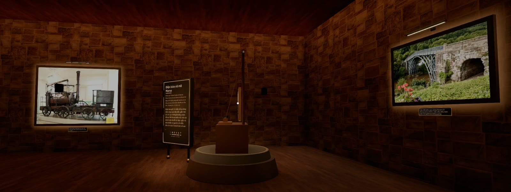1<b>Quan sát</b>
Hiện vật 3D

2<b>Đọc</b>
Bảng thông tin

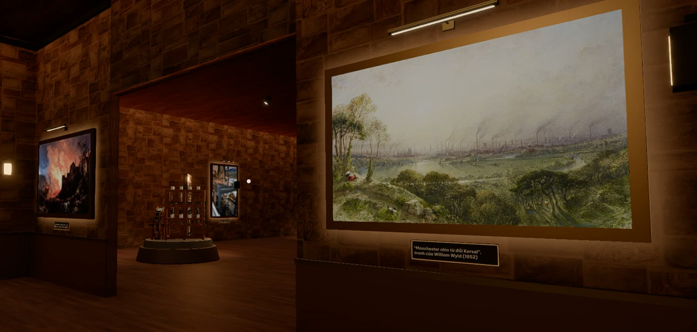3<b>Đối chiếu</b>
Ảnh và nguồn

4<b>Vận dụng</b>
Bốn vòng trò chơi

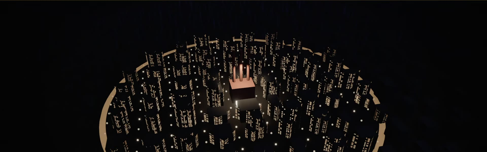5<b>Hiểu</b>
Mở cánh cổng

<b>Từ ghi nhớ năm tháng đến hiểu dòng chảy lịch sử.</b>

---

<!--
[Slide 13 · ~15 giây]
"Mọi nội dung đều có nguồn: Britannica, Science Museum Group, Thư viện Quốc hội Hoa Kỳ và nhiều nơi khác. Ảnh lấy từ Wikimedia Commons, tác giả và giấy phép được ghi công ngay trong bảo tàng."
-->

# Nguồn tư liệu và ghi công

<h3>Nguồn nội dung</h3>
Britannica · Science Museum Group · Thư viện Quốc hội Hoa Kỳ

<h3>Hình ảnh</h3>
Wikimedia Commons · tác giả và giấy phép dưới mỗi ảnh

<h3>Ghi công</h3>
Bảng "Ghi công" ở sảnh trung tâm

---

<!-- _class: dark -->
<!-- _footer: "" -->
<!--
[Slide 14 · ~16 giây]
"Tóm lại: mỗi cuộc cách mạng công nghiệp kế thừa nền tảng của cuộc trước, mở rộng khả năng sản xuất và kết nối, đồng thời tạo ra những thay đổi và thách thức mới. Xin cảm ơn thầy cô và các bạn."
Đọc luận điểm thật chậm.
-->

Kết luận · Nhóm INOVAT

Mỗi cuộc cách mạng công nghiệp kế thừa nền tảng của cuộc trước, mở rộng khả năng sản xuất và kết nối, đồng thời tạo ra những thay đổi và thách thức mới.

<figure>CMCN 1</figure>→
<figure>CMCN 2</figure>→
<figure>CMCN 3</figure>→
<figure>CMCN 4</figure>

Nguyễn Hoàng · Nguyễn Phúc Khánh Linh · Đỗ Minh Hải · Lê Khôi Nguyên · Ngô Quang Anh

---

<!-- _class: qa -->
<!-- _paginate: false -->
<!--
[Slide 15 · Hỏi đáp]
"Xin cảm ơn. Xin mời thầy cô và các bạn đặt câu hỏi."
Trả lời theo thứ tự: Kết luận, Lý do, Dẫn chứng, Thừa nhận giới hạn. Nếu không chắc: "Chúng em xin phép kiểm tra lại nguồn và bổ sung." Ngân hàng câu hỏi: ghi chú Q&A.
-->

Xin cảm ơn.

Q&amp;A

inovat-museum.vercel.app

